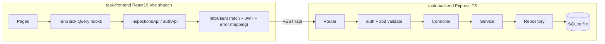

# Quality Inspection Tracker - Full Plan

Source: [FSD_Assignment.docx](FSD_Assignment.docx). The decisions you made are a lean backend on Express + SQLite, with JWT auth as the only bonus feature.

## Architecture



Principles applied:
- **SRP (single responsibility):** each backend layer has one job. Routes handle HTTP wiring, controllers map HTTP to the service, services hold business rules, and repositories hold SQL.
- **DIP (dependency inversion):** services depend on a repository interface, so tests can inject an in-memory SQLite database.
- **DRY:** domain enums are defined once per app in a `constants` module and drive the Zod schemas, the dropdowns, the badges, and the summary rows. A single `validate(schema)` middleware and a single `sendSuccess` / error-handler response shape cover every endpoint.
- **Exhaustive `switch` + `never`** for every place that switches over severity or status.

## Backend - `task-backend` (rewritten lean)

Delete the boilerplate (Mongo, Redis, S3, tsoa, puppeteer, sockets, workers), then reuse the ideas behind `ApiError` and its subclasses from [task-backend/src/errors/ApiError.ts](task-backend/src/errors/ApiError.ts).

Stack: Express 5, TypeScript, `better-sqlite3`, `zod`, `jsonwebtoken`, `bcryptjs`, `helmet`, `cors`, `pino` for logging, `vitest` + `supertest`, and `tsx` for the dev server.

```
src/
  config/env.ts                 # zod-validated env (PORT, DB_PATH, JWT_SECRET, CORS_ORIGIN)
  db/connection.ts              # creates better-sqlite3 instance (file or :memory:)
  db/migrate.ts                 # idempotent CREATE TABLE IF NOT EXISTS + indexes
  db/seed.ts                    # seeds demo supervisor + sample inspections
  shared/errors.ts              # AppError, NotFound, Conflict, Unauthorized, ValidationFailed
  shared/http.ts                # sendSuccess(res, data, status)
  shared/middleware/validate.ts # validate({ body, query, params })
  shared/middleware/requireAuth.ts
  shared/middleware/errorHandler.ts
  modules/auth/{auth.schema,auth.service,auth.controller,auth.routes,user.repository}.ts
  modules/inspections/{inspection.constants,inspection.schema,inspection.repository,inspection.service,inspection.controller,inspection.routes}.ts
  app.ts                        # createApp(deps) factory - testable
  server.ts                     # bootstraps db + listen
```

**Data model**
- `users`: `id`, `email` (unique), `name`, `password_hash`, `created_at`.
- `inspections`: `id` (uuid), `inspection_date` (YYYY-MM-DD), `machine_id`, `defect_type` (CHECK in the enum), `severity` (CHECK), `remarks` (nullable), `status` (CHECK Open/Resolved, default Open), `resolution_note`, `resolved_at`, `created_by` (FK to users), `created_at`, `updated_at`.
- Indexes on `status`, `severity`, and `inspection_date`.

**API** (all routes except login and health require `Authorization: Bearer`)
- `POST /api/auth/login` returns 200 with `{ token, user }`, or 401.
- `GET /api/auth/me` returns 200 with the current user.
- `GET /api/inspections?severity=&status=&from=&to=&sortBy=inspectionDate|severity|createdAt&order=asc|desc` returns 200. Multiple severity/status values are passed comma-separated. A whitelisted sort column map prevents SQL injection, and severity sorts by rank (Critical > Major > Minor) using a `CASE` expression.
- `POST /api/inspections` returns 201 with the created record.
- `GET /api/inspections/:id` returns 200 or 404.
- `PATCH /api/inspections/:id/resolve` with body `{ resolutionNote }` (required, trimmed, 3-500 chars) returns 200. It returns 404 if the record is missing and 409 if it is already resolved.
- `GET /api/inspections/summary` returns 200 with `[{ severity, open, resolved, total }]`, using one `GROUP BY` query whose result is padded to cover all severities.
- `GET /api/health` returns 200.

**Response shape** (identical for every endpoint)
- Success: `{ "success": true, "data": ... }`
- Failure: `{ "success": false, "error": { "code": "VALIDATION_FAILED", "message": "...", "details": [...] } }`. Status codes are 400, 401, 404, 409, 422 (Zod validation), and 500.

Repository methods use camelCase domain objects and do the snake_case mapping in exactly one function, `toInspection(row)`.

## Frontend - `task-frontend` with shadcn/ui

**Setup:** add Tailwind v4 via `@tailwindcss/vite`, then run `npx shadcn@latest init`. Write `components.json` aliases so components land in `@/shared/components/ui`. Replace the custom CSS in [task-frontend/src/index.css](task-frontend/src/index.css) with Tailwind plus shadcn theme tokens, keeping the brand green `#0f6e56` as `--primary`. Delete the hand-rolled [Button.tsx](task-frontend/src/shared/components/ui/Button.tsx) and [Input.tsx](task-frontend/src/shared/components/ui/Input.tsx) in favor of the shadcn versions.

**shadcn components:** button, input, textarea, label, select, form, card, badge, dialog, drawer (for mobile bottom sheets), sheet, skeleton, sonner, separator, dropdown-menu, toggle-group.

**Other dependencies:** `@tanstack/react-query`, `react-hook-form`, `@hookform/resolvers`, `zod`, `lucide-react`, `date-fns`.

**Structure**

```
src/
  app/router.tsx                       # routes: /login, /inspections, /inspections/new, /summary
  app/layouts/AppLayout.tsx            # mobile: top bar + fixed bottom tab nav; md+: side nav
  app/providers/AppProviders.tsx       # QueryClientProvider + AuthProvider + Toaster
  shared/api/httpClient.ts             # fetch wrapper: base URL, token, unwraps {success,data}, throws ApiError; 401 -> onUnauthorized
  shared/components/{PageHeader,EmptyState,ErrorState,LoadingList}.tsx
  shared/components/form/{FormInput,FormSelect,FormTextarea}.tsx   # reusable RHF+shadcn field wrappers
  features/auth/...                    # AuthContext calls /api/auth/login + /me (replaces demo session)
  features/inspections/
    constants.ts       # DEFECT_TYPES, SEVERITIES, STATUSES, SEVERITY_RANK, labels
    types.ts           # Inspection, InspectionFilters, SummaryRow
    schemas.ts         # zod: createInspectionSchema, resolveInspectionSchema
    api/inspectionsApi.ts
    hooks/{useInspections,useInspectionSummary,useCreateInspection,useResolveInspection}.ts
    hooks/useInspectionFilters.ts      # filters/sort <-> URL search params (shareable, back-button safe)
    lib/queryKeys.ts                   # inspectionKeys factory; mutations invalidate list + summary
    components/
      InspectionForm.tsx               # date defaults to today, native date input (best on mobile)
      InspectionList.tsx / InspectionCard.tsx
      InspectionFilters.tsx            # Drawer on mobile: severity/status toggle groups, from/to dates, clear
      SortMenu.tsx
      ResolveInspectionDialog.tsx      # mandatory note, Drawer on mobile / Dialog on desktop
      SeverityBadge.tsx / StatusBadge.tsx   # exhaustive switch -> variant
      SummaryGrid.tsx                  # cards per severity with Open/Resolved/Total
    pages/{InspectionsPage,NewInspectionPage,SummaryPage}.tsx
```

The existing Home, Dashboard, Settings, and Profile pages will be removed, and `/` will redirect to `/inspections`.

**React best practices**
- Server state lives in TanStack Query; there is no duplicated `useState` for it.
- Filter state lives in the URL.
- Forms are controlled through react-hook-form with a Zod resolver.
- Mutations do a targeted query invalidation and show a toast.
- Every view handles loading, error, and empty states.
- The React Compiler is already enabled, so there is no manual memoization.
- Accessibility: labels, focus management through Radix, and 44px touch targets.
- Compact controls follow the AGENTS.md rule of tokenized fixed heights with flex centering.

**Mobile UX at 390px**
- A bottom tab bar with List, a raised center "+ New" button, and Summary.
- Inspections show as cards, not a table.
- Filters open in a bottom drawer, and an active-filter count appears on its button.
- Resolving takes one tap to open the drawer, then the note, then confirm.

## Delivery

- **Root [docker-compose.yml](docker-compose.yml):**
  - The backend service mounts a volume for the SQLite file and runs migrate and seed on start.
  - The frontend service is built and then served by nginx, which proxies `/api` to the backend.
- **Local dev:** a Vite proxy forwards `/api` to `localhost:4000`. There are `.env.example` files for both apps.
- **Root `README.md` sections:**
  - Setup in under 5 minutes, with both Docker and npm options, plus the demo credentials.
  - API reference.
  - Architecture decisions (2-3 sentences each): why SQLite, why a layered backend, why TanStack Query, why shadcn, and why filters live in the URL.
  - Assumptions: one supervisor role, dates without time, resolution is irreversible, and the date-range filter is inclusive.
  - What was cut (offline support and the SAP webhook) and what I would do with more time.
- Create `tasks/todo.md` and `tasks/lessons.md` as AGENTS.md requires, and run `git init` at the root.

## Verification

- **Backend:** run Vitest + Supertest against in-memory SQLite. Cover:
  - Creating an inspection (201 for valid input, 422 for invalid).
  - Each filter combination and the severity sort order.
  - Resolving (200, then 409 on a second resolve, and 422 for an empty note).
  - The summary counts.
  - A 401 without a token.
- **Frontend:** run Vitest + React Testing Library on `useInspectionFilters` parsing, `InspectionForm` validation, and `ResolveInspectionDialog` requiring a note. Also run `tsc -b`, `oxlint`, and `vite build`.
- **End to end:** run `docker compose up`, then use the browser at a 390px viewport to log in, create an inspection, filter and sort, resolve it, and check that the summary updates. Capture screenshots for the README.